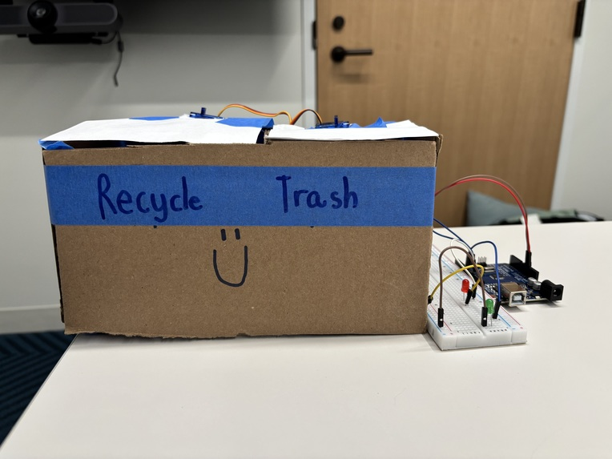
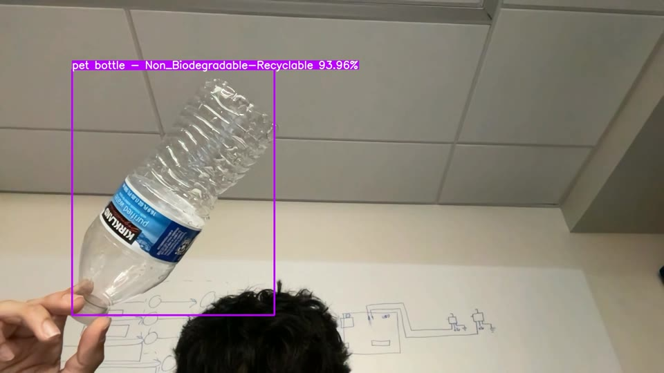
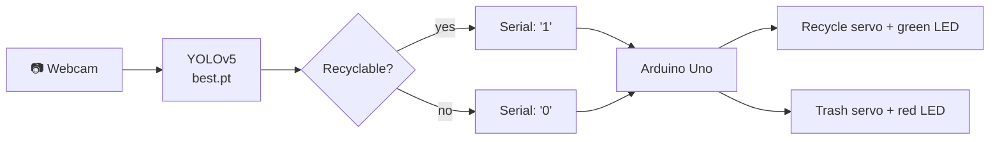
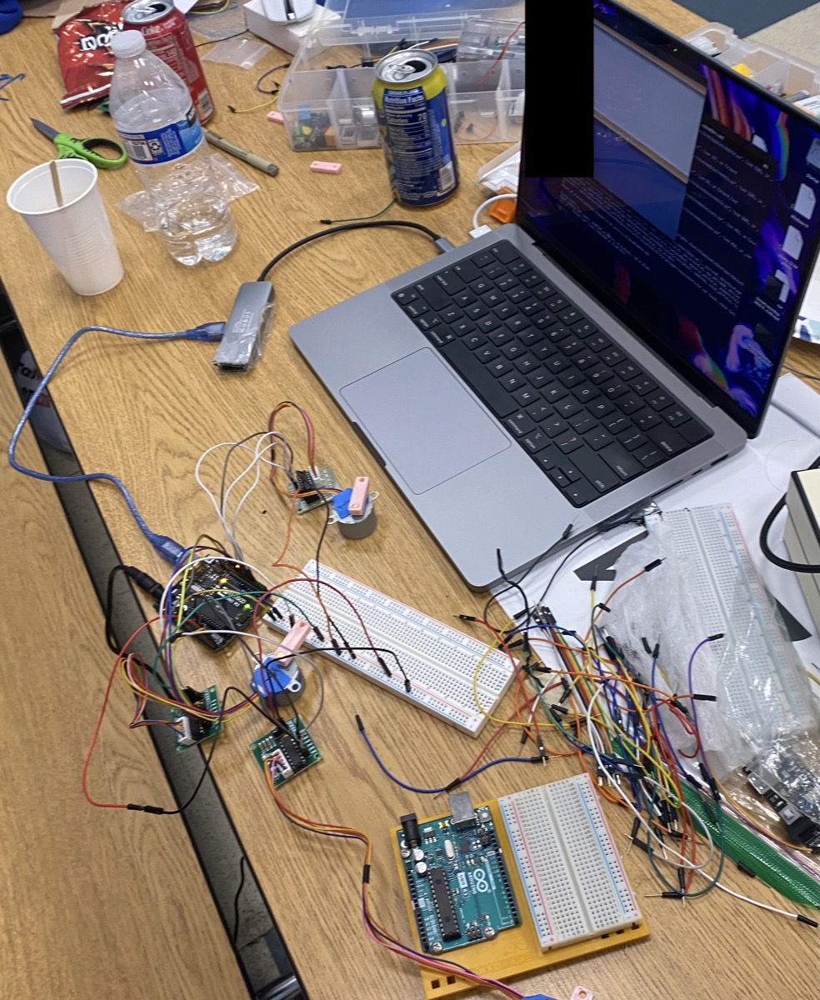

<div align="center">

# ♻️ BinSense

**A smart trash can that uses computer vision to sort waste into recycling or trash automatically.**




</div>

## About

People often aren't sure whether something is recyclable, so recycling bins end up contaminated. BinSense removes the guesswork. You hold an item up to the camera, a custom-trained **YOLOv5** model identifies it, and an **Arduino** opens the matching lid: **recycling** or **trash**. An LED lights up to confirm the choice.

<p align="center">
  
  <br><em>The model classifying a PET bottle as recyclable, with 94% confidence</em>
</p>

## Features

- **Real-time object detection** on a webcam feed, using a YOLOv5 model fine-tuned on 19 household-waste classes
- **Automatic sorting**: servos open the recycling or trash lid and close it again after 3 seconds
- **LED feedback**: green for recycling, red for trash
- **Live HUD** built with OpenCV, showing running recycling and trash counts, the recycling rate, the current detection with its confidence, and a screen flash on each sort
- **False-trigger protection**: a sort fires only at ≥ 70% confidence, with per-class confidence overrides and cooldowns on both the Python and Arduino sides

## How it works



1. [`yolov5/binsense.py`](yolov5/binsense.py) reads frames from the webcam and runs them through the custom model, [`yolov5/best.pt`](yolov5/best.pt).
2. It keeps the highest-confidence detection in each frame and maps its class to *recycle* or *trash*.
3. If the confidence is ≥ 0.70 and the 3-second cooldown has passed, it sends `1` (recycle) or `0` (trash) to the Arduino over USB serial at 9600 baud.
4. [`firmware/binsense/binsense.ino`](firmware/binsense/binsense.ino) swings the matching servo open for 3 seconds and lights its LED, then ignores further input for 5 seconds.

### Model

The model is YOLOv5 fine-tuned on the [Household Waste dataset](https://universe.roboflow.com/grpglmthesis/thesis-unztx/dataset/19) from Roboflow Universe (about 3,000 images across 19 classes, CC BY 4.0).

| Sorted as **recycling** | Sorted as **trash** |
|---|---|
| PET bottle, plastic bottle, glass bottle, plastic container, egg shell, tree leaves | Face mask, food wrapper, plastic bag, plastic sachet, plastic straw |

Paper, cardboard, aluminum, UHT carton, fruit and vegetable peels, left-over food, and styrofoam are **turned off** in `class_conf_overrides`, because they caused false positives during testing. To turn one back on, remove its entry from that dictionary.

## Hardware

| Part | Qty |
|---|---|
| Arduino Uno (or compatible) | 1 |
| SG90 / MG90S micro servo | 2 |
| Red LED and green LED, each with a 220 Ω resistor | 1 each |
| USB webcam (or a laptop camera) | 1 |
| Two-compartment box, breadboard, jumper wires | — |

### Wiring

| Component | Arduino pin |
|---|---|
| Trash servo signal | D8 |
| Recycle servo signal | D11 |
| Red LED (trash) | D12 |
| Green LED (recycle) | D7 |
| Servo VCC / GND | 5V / GND |

> **Tip:** Two servos moving at once can draw more current than USB can supply. If the Arduino resets in the middle of a sort, power the servos from a separate 5V supply that shares a common ground with the Arduino.

## Getting started

### Prerequisites

- Python 3.9+
- [Arduino IDE](https://www.arduino.cc/en/software)
- The hardware above, connected to your computer over USB

### 1. Flash the Arduino

Open `firmware/binsense/binsense.ino` in the Arduino IDE, select your board and port, and click **Upload**.

### 2. Install the Python dependencies

```bash
git clone https://github.com/alaapjoshi/BinSense.git
cd BinSense/yolov5
python3 -m venv .venv && source .venv/bin/activate
pip install -r requirements.txt
```

### 3. Find the Arduino's serial port

```bash
ls /dev/cu.usb*                 # macOS
ls /dev/ttyUSB* /dev/ttyACM*    # Linux
```

On Windows, look in Device Manager for a port such as `COM3`.

### 4. Run BinSense

```bash
python binsense.py --port /dev/cu.usbserial-XXXX
```

Hold an item in front of the camera. When the model is confident enough, the matching lid opens.

| Flag | Default | Description |
|---|---|---|
| `--port` | `/dev/cu.usbserial-2120` | Arduino serial port |
| `--source` | `0` | Webcam index, or a path to an image or video |
| `--weights` | `best.pt` | Model weights |
| `--conf-thres` | `0.35` | Minimum confidence for a detection to be drawn |
| `--device` | auto | `cpu`, `mps`, or a CUDA index such as `0` |

## Project structure

```
BinSense/
├── firmware/
│   └── binsense/
│       └── binsense.ino      # Arduino firmware: servos and LEDs, driven by serial commands
├── yolov5/                   # Ultralytics YOLOv5, vendored
│   ├── binsense.py           # ⭐ Main app: detection, sorting logic, HUD, serial output
│   ├── best.pt               # ⭐ Custom-trained waste-detection weights
│   └── ...                   # Upstream YOLOv5 (models, utils, training scripts)
├── legacy/
│   └── intellibin/           # v1 hackathon prototype (see below)
└── docs/images/              # README images
```

## Project history



BinSense began as **Intellibin**, a hackathon project in 2023. That first version tried a three-way sort (trash, recycling, and compost) using 28BYJ-48 stepper motors. It decided where an item went by matching substrings in the class names. The code is preserved in [`legacy/intellibin/`](legacy/intellibin/).

BinSense is the rebuild, based on what that prototype taught:

| | Intellibin (v1) | BinSense (v2) |
|---|---|---|
| Actuators | 3 stepper motors (slow, 10 s per sort) | 2 servos (fast, 3 s per sort) |
| Sorting logic | Substring matching on class names | Explicit class-to-bin mapping, with per-class confidence overrides |
| Serial protocol | `parseInt()`, with a new connection opened on every detection | One persistent connection that sends single characters |
| False triggers | None handled | Confidence threshold, plus cooldowns on both sides |
| UI | Default YOLOv5 window | Custom HUD with live stats |

<br clear="right">

## Roadmap

- [ ] Retrain with more paper, cardboard, and aluminum images, so those classes can be turned back on
- [ ] Run the model on a Raspberry Pi so the bin doesn't need a laptop
- [ ] Add a third compartment for compost
- [ ] Log sort counts to a web dashboard

## Acknowledgments

- [Ultralytics YOLOv5](https://github.com/ultralytics/yolov5), the detection framework
- [Household Waste dataset](https://universe.roboflow.com/grpglmthesis/thesis-unztx/dataset/19) on Roboflow Universe (CC BY 4.0)

## License

BinSense builds on YOLOv5, which is licensed under AGPL-3.0, so this project is released under the same [license](LICENSE).
