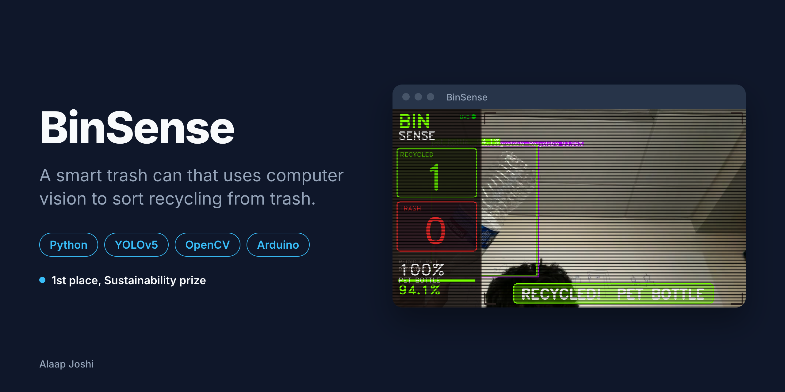
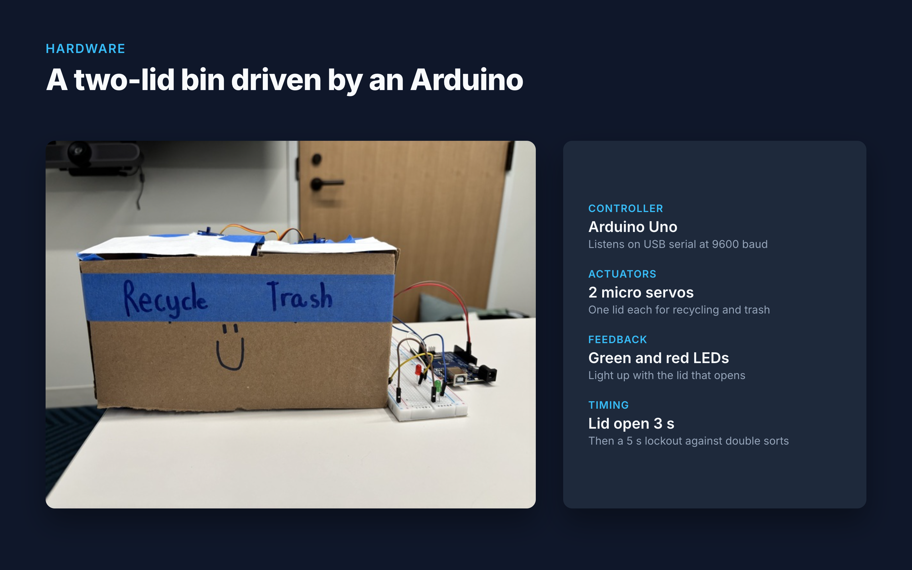
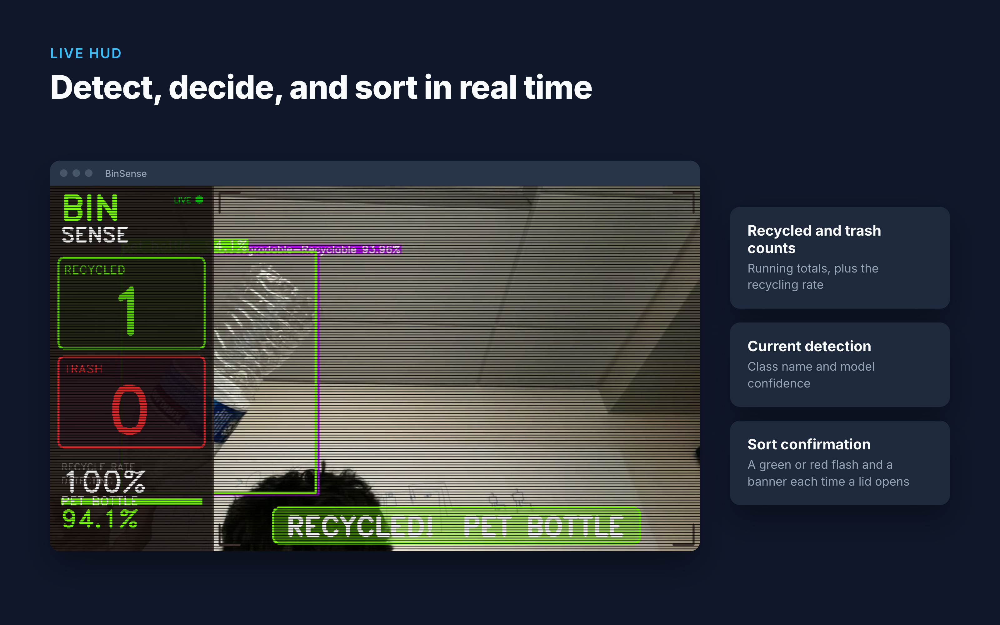
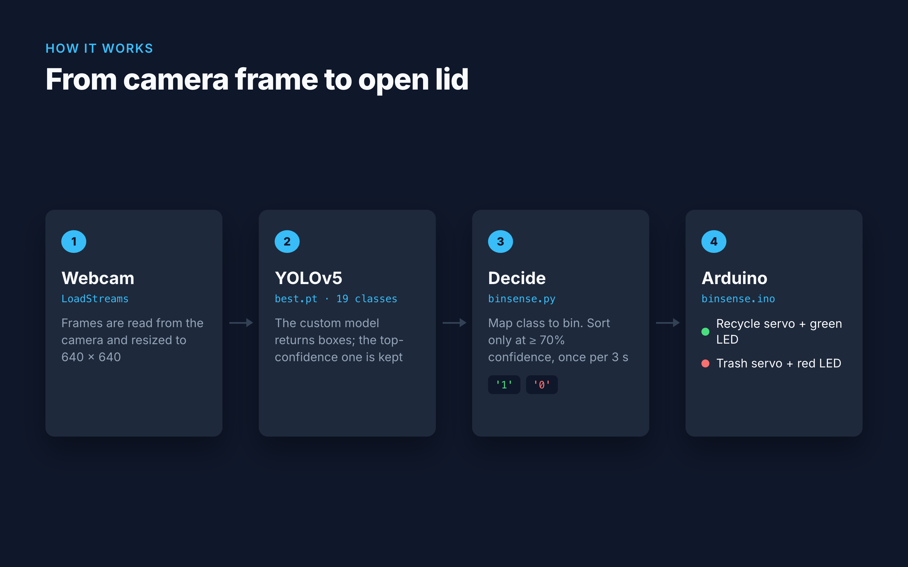
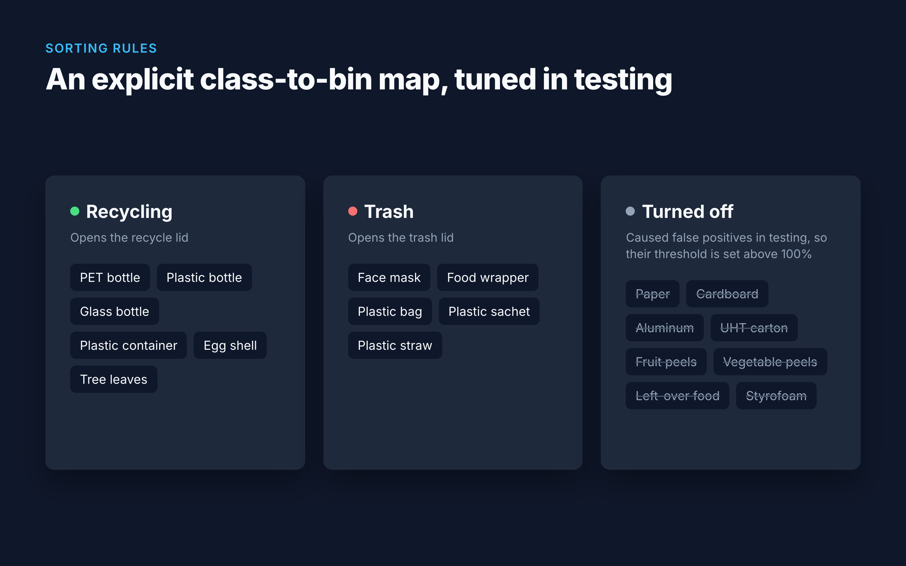
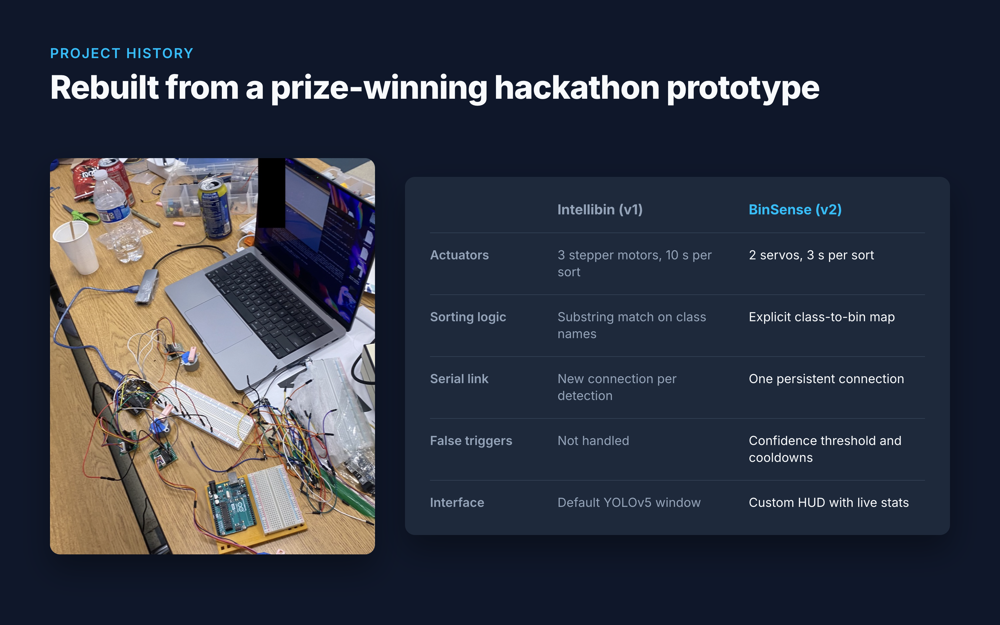
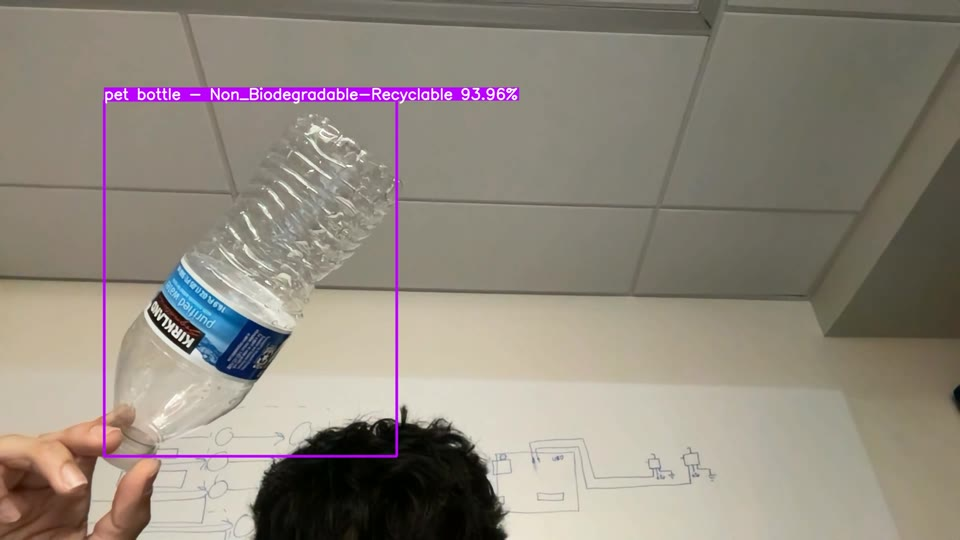

# BinSense

> A smart trash can that uses computer vision to sort recycling from trash, so people don't have to guess.

   

## About

People often aren't sure whether something is recyclable, so recycling bins end up contaminated. BinSense takes the decision away: you hold an item up to a camera, a custom-trained YOLOv5 model identifies it, and an Arduino opens the matching lid. It started as **Intellibin**, which won **1st place in the Sustainability category** at a hackathon ([Devpost](https://devpost.com/software/intellibin)), and was then rebuilt to be faster and far less error-prone.

## Features

- Detects 19 classes of household waste in a live webcam feed with a fine-tuned YOLOv5 model.
- Opens the recycling or trash lid with a servo, then closes it after 3 seconds.
- Lights a green or red LED to confirm each sort.
- Shows a live HUD with running recycled and trash counts, the recycling rate, and the current detection with its confidence.
- Prevents false sorts with a 70% confidence threshold, per-class overrides, and cooldowns on both the Python and Arduino sides.

## Gallery

<table>
  <tr>
    <td width="50%"> The two-lid bin, servos, and Arduino</td>
    <td width="50%"> The live HUD after sorting a PET bottle (94.1% confidence)</td>
  </tr>
  <tr>
    <td width="50%"> The pipeline from camera frame to open lid</td>
    <td width="50%"> The class-to-bin map, including classes turned off after testing</td>
  </tr>
  <tr>
    <td width="50%"> What changed from the Intellibin prototype to BinSense</td>
    <td width="50%"> A raw detection from the model, before the HUD was added</td>
  </tr>
</table>

## Tech Stack

| Layer | Technology |
|---|---|
| Computer vision | YOLOv5 (PyTorch), custom-trained weights |
| Application | Python, OpenCV (capture and HUD), pyserial |
| Hardware | Arduino Uno, 2 micro servos, red and green LEDs |
| Data | [Household Waste dataset](https://universe.roboflow.com/grpglmthesis/thesis-unztx/dataset/19) from Roboflow Universe (CC BY 4.0) |

## Getting Started

### Prerequisites

- Python 3.9+
- [Arduino IDE](https://www.arduino.cc/en/software)
- A USB webcam (or a laptop camera)
- The hardware, connected to your computer over USB:

| Part | Arduino pin |
|---|---|
| Trash servo signal | D8 |
| Recycle servo signal | D11 |
| Red LED (trash), with a 220 Ω resistor | D12 |
| Green LED (recycle), with a 220 Ω resistor | D7 |
| Servo power | 5V and GND |

Two servos moving at once can draw more current than USB supplies. If the Arduino resets during a sort, power the servos from a separate 5V supply that shares a ground with the Arduino.

### Installation

1. Open `firmware/binsense/binsense.ino` in the Arduino IDE, select your board and port, and click **Upload**.
2. Install the Python side:

~~~bash
git clone https://github.com/alaapjoshi/BinSense.git
cd BinSense/vision
python3 -m venv .venv && source .venv/bin/activate
pip install -r requirements.txt
~~~

### Usage

Find the Arduino's serial port:

~~~bash
ls /dev/cu.usb*                 # macOS
ls /dev/ttyUSB* /dev/ttyACM*    # Linux
~~~

On Windows, look in Device Manager for a port such as `COM3`. Then start BinSense:

~~~bash
python binsense.py --port /dev/cu.usbserial-XXXX
~~~

A window titled **BinSense** opens with the camera feed and HUD. Hold an item in front of the camera. When the model is at least 70% confident, the matching lid opens, its LED lights, and the HUD counts the sort.

| Flag | Default | Description |
|---|---|---|
| `--port` | `/dev/cu.usbserial-2120` | Arduino serial port |
| `--source` | `0` | Webcam index, or a path to an image or video |
| `--weights` | `best.pt` | Model weights |
| `--conf-thres` | `0.35` | Minimum confidence for a detection to be drawn |
| `--device` | auto | `cpu`, `mps`, or a CUDA index such as `0` |

## Project Structure

~~~text
BinSense/
  vision/
    binsense.py        # Main app: detection, sorting logic, HUD, serial output
    best.pt            # Custom-trained waste-detection weights
    models/, utils/    # YOLOv5 inference code (vendored from Ultralytics)
  firmware/binsense/   # Arduino firmware: servos and LEDs, driven by serial commands
  legacy/intellibin/   # The original hackathon prototype (v1)
  docs/images/         # README images; src/ holds the files that generate them
~~~

## How It Works

~~~mermaid
flowchart LR
    A[Webcam] --> B[YOLOv5 best.pt]
    B --> C{Recyclable?}
    C -- yes --> D["Serial: '1'"]
    C -- no --> E["Serial: '0'"]
    D --> F[Arduino Uno]
    E --> F
    F --> G[Recycle servo + green LED]
    F --> H[Trash servo + red LED]
~~~

1. [`vision/binsense.py`](vision/binsense.py) reads webcam frames and runs them through the custom model, [`vision/best.pt`](vision/best.pt).
2. It keeps the highest-confidence detection in each frame and looks up its class in an explicit recycle or trash set.
3. If the confidence is at least 0.70 and 3 seconds have passed since the last sort, it sends `1` (recycle) or `0` (trash) to the Arduino over one persistent serial connection at 9600 baud.
4. [`firmware/binsense/binsense.ino`](firmware/binsense/binsense.ino) swings the matching servo open for 3 seconds and lights its LED, then ignores input for 5 seconds.

### Model

YOLOv5 fine-tuned on the Household Waste dataset (about 3,000 images, 19 classes).

| Sorted as recycling | Sorted as trash |
|---|---|
| PET bottle, plastic bottle, glass bottle, plastic container, egg shell, tree leaves | Face mask, food wrapper, plastic bag, plastic sachet, plastic straw |

Paper, cardboard, aluminum, UHT carton, fruit and vegetable peels, left-over food, and styrofoam caused false positives in testing (for example, faces were detected as paper), so their confidence threshold in `class_conf_overrides` is set above 100%. Removing an entry turns that class back on.

### From Intellibin to BinSense

The hackathon version, kept in [`legacy/intellibin/`](legacy/intellibin/), sorted three ways with stepper motors. Rebuilding it fixed these problems:

| | Intellibin (v1) | BinSense (v2) |
|---|---|---|
| Actuators | 3 stepper motors, about 10 s per sort | 2 servos, 3 s per sort |
| Sorting logic | Substring matching on class names (`"Biodegradable"` also matched `"Non_Biodegradable"`) | Explicit class-to-bin map |
| Serial link | New connection on every detection, which reset the Arduino | One persistent connection |
| False triggers | Not handled | Confidence threshold and cooldowns |
| Interface | Default YOLOv5 window | Custom HUD with live stats |

## Future Improvements

- Retrain with more paper, cardboard, and aluminum images so those classes can be turned back on.
- Run the model on a Raspberry Pi so the bin works without a laptop.
- Add a third compartment for compost.
- Log sort counts to a web dashboard.

## Author

**Alaap Joshi** - Computer Science + Cognitive Science, Rutgers University-New Brunswick
[GitHub](https://github.com/alaapjoshi) | [LinkedIn](https://linkedin.com/in/alaapjoshi)

## License

AGPL-3.0. See [LICENSE](LICENSE). BinSense includes inference code from [Ultralytics YOLOv5](https://github.com/ultralytics/yolov5), which is AGPL-3.0, so the project uses the same license. The training data is the [Household Waste dataset](https://universe.roboflow.com/grpglmthesis/thesis-unztx/dataset/19) (CC BY 4.0).
